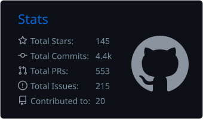
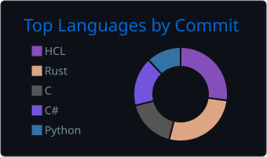

# Hi, I'm Kirill 👋

Software developer in Berlin. Geek, machining and 3D printing enthusiast.
I build self-hosted tools, run a Kubernetes homelab, and write firmware for small gadgets on my desk.

- 🦀 Mostly **Rust** these days, with a long history in **C#** and **Java**
- 🏠 Everything I use runs on my own [homelab](https://github.com/DiverOfDark/homelab): HA multi-master Kubernetes
- 🤖 Lately: AI agents, LLM tooling and local vision models
- 🌐 [kirillorlov.pro](http://kirillorlov.pro)

## 🔧 Hardware & firmware

| Project | What it is |
|---|---|
| [stackchan](https://github.com/DiverOfDark/stackchan) | Femto: Rust/ESP-IDF firmware for M5Stack StackChan, a robot butler with face tracking and voice |
| [trmnl-cyberpunk](https://github.com/DiverOfDark/trmnl-cyberpunk) | Neo-Tokyo dashboard server for a TRMNL e-ink display (Rust) |
| [KNOMI](https://github.com/DiverOfDark/KNOMI) | Alternative, opinionated firmware for BTT Knomi 3D-printer displays (C) |

## 🧠 AI tools

| Project | What it is |
|---|---|
| [adjutant](https://github.com/DiverOfDark/adjutant) | Agentic Markdown knowledge base for managers, works with any ACP agent (Rust) |
| [phos](https://github.com/DiverOfDark/phos) | AI photo and video manager with face clustering and similarity grouping (Rust) |
| [difflab](https://github.com/DiverOfDark/difflab) | Video factory on one GPU: an idea and a few photos in, a chapter of shots out (Python) |

## ☸️ Kubernetes & infra

| Project | What it is |
|---|---|
| [cluster-desk](https://github.com/DiverOfDark/cluster-desk) | Fast desktop Kubernetes UI in Rust/egui |
| [kata-pulse](https://github.com/DiverOfDark/kata-pulse) | cAdvisor-compatible metrics for Kata Containers (Rust) |
| [peelbox](https://github.com/DiverOfDark/peelbox) | Builds secure Docker images out of anything (Rust) |

## 📊 Stats

 
